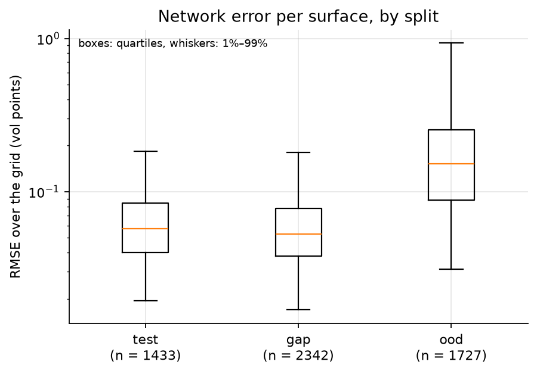
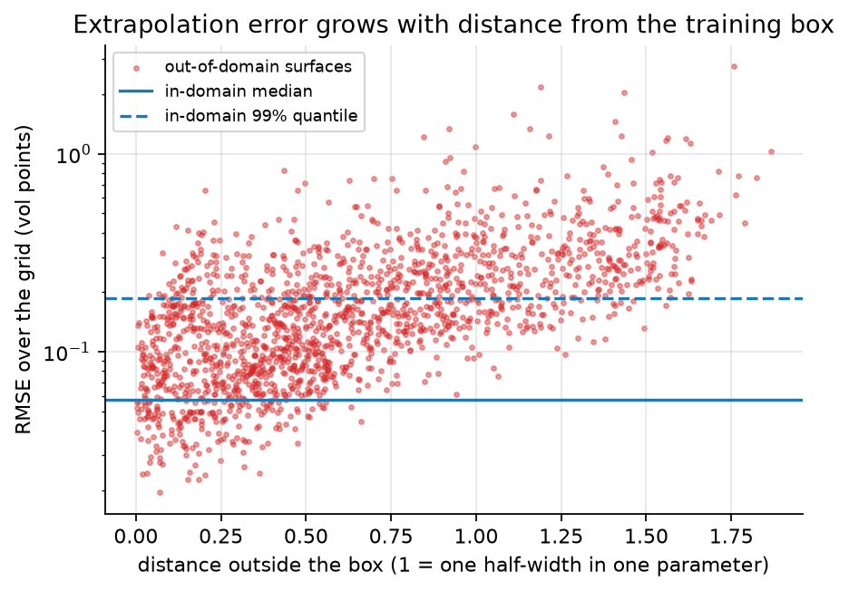
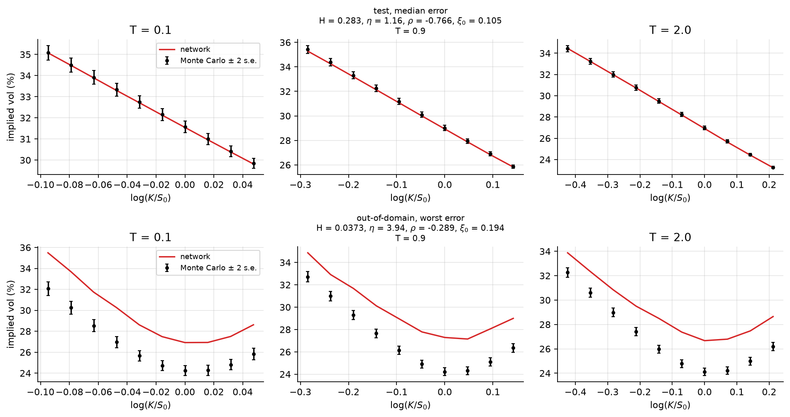
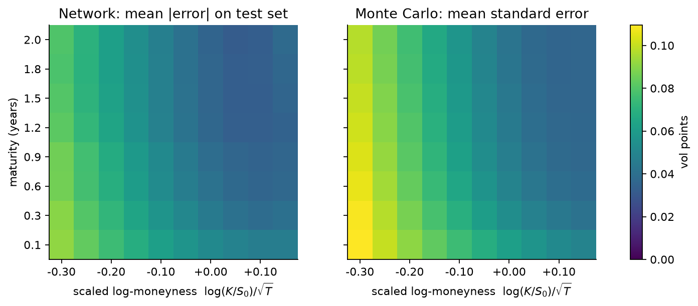
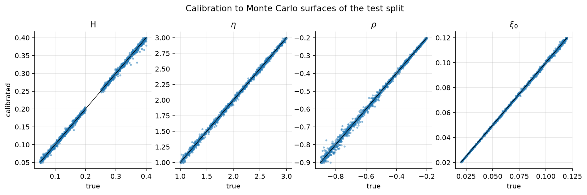
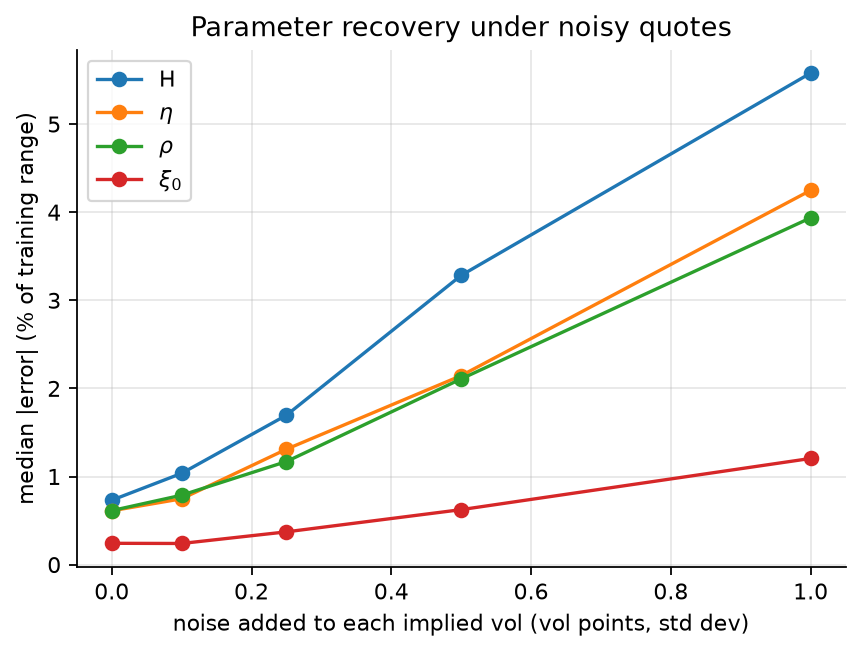

# Rough Bergomi neural network: where a pricing surrogate works, and where it breaks

The rough Bergomi model fits equity volatility surfaces with three parameters,
but it has no closed-form prices: every surface costs a Monte Carlo simulation,
and a calibration needs dozens of them. A neural network trained on simulated
surfaces can replace the simulator and make calibration thousands of times faster.

This project asks the question a model validation desk would ask next: **when can the network be
trusted?** The network is evaluated separately on parameters like those it was
trained on, on a hole deliberately cut out of the training data, and on
parameters outside the training range.

For an in-depth analysis of the underlying mechanism, especially the Bergomi model itself, see the [theory notebook](docs/theory.ipynb).  


## Steps

1. **Generate the data.** There is no closed-form solution, so option prices are
   simulated with Monte Carlo and inverted to implied volatility with
   Black–Scholes. Each price is noisy, and the noise is recorded. The simulator
   is validated first ([details](docs/simulator.md)).
2. **Train the network.** It learns the map from parameters to a vol
   surface on the synthetic dataset:
   $$f(H, \, \eta, \, \rho, \, \xi_0) \rightarrow IV(K,T)$$
3. **Calibrate.** Calibration is the most expensive part of the workflow, since
   it needs many prices; the network is what cuts this cost. A surface is
   generated with known parameters and the network is asked to recover them by
   minimising $\sum (IV_{mkt} - IV_{model})^2$.
4. **Test where it can be trusted.** Three kinds of test surfaces are used:
   *in-domain*, *interpolation gap* ($H$ between 0.20 and 0.25, deliberately
   removed from training) and *out-of-domain*.

In short: the network is very fast and interpolates well, but extrapolates
poorly. Its error (0.076 vol points) is almost the same as the Monte Carlo
noise (0.074). Noise on the target prices makes the recovered parameters worse,
$H$ most of all. Outside the domain calibration fails, which is expected, but it
fails visibly and is therefore easy to monitor. Synthetic data is a limitation,
but it is what allows measuring how well the true parameters are recovered; the
exercise could later be repeated on market data.

> **Disclaimer:** The Monte Carlo section was developed entirely by Claude Code (Fable 5.2).


## Findings

All errors are in volatility points (1 vol point = 1% of implied volatility),
measured against Monte Carlo on surfaces never used for training.

| | surfaces | Network RMSE | Worst grid point | Monte Carlo noise |
|---|---:|---:|---:|---:|
| **In-domain** test | 1,433 | 0.076 | 0.67 | 0.074 |
| **Interpolation gap** (removed from training) | 2,342 | 0.071 | 0.61 | 0.068 |
| **Out-of-domain** (outside the training box) | 1,727 | 0.281 | 3.71 | 0.098 |

1. **Inside the training domain the network is as accurate as the data it learned from.** 
   Its error against Monte Carlo (0.076) is almost entirely the
   Monte Carlo noise of the comparison surfaces (0.074). Removing that noise in
   quadrature leaves roughly 0.02 vol points of genuine approximation error.
   Training and test errors coincide, which means that there is no overfitting.
2. **A hole in the training data does no harm.** The network never saw a Hurst
   exponent between 0.20 and 0.25, yet its error there is the same as elsewhere.
   The pricing map is smooth, and interpolating across a gap surrounded by data
   is easy.
3. **Extrapolation fails, gradually and then badly.** Per surface, the median
   error is 0.06 in-domain. Just outside the box it is 0.09; more than one
   half-width out it is 0.30, five times the in-domain level (95% quantile
   0.77), and the worst grid point is off by 3.7 vol points. These errors are
   small in absolute terms; the concern is the tail, and the fact that the
   network gives no warning of its own. The most damaging directions are a
   variance level `ξ0` or a vol-of-vol `η` above the training range.
4. **Calibration is about 2,300 times faster and recovers the parameters.**
   15 ms per calibration against 35 s with the simulator in the loop. On
   Monte Carlo surfaces, which carry about 0.07 vol points of noise of their own,
   the median error is below 1% of each
   parameter's range.
5. **Out-of-domain calibration fails loudly, which is what makes it usable.**
   When the true parameters lie outside the box, 99% of calibrations stop on a
   bound (by construction, since the optimiser is confined to the box) and the
   fit error is 20 times the in-domain level (0.68 against 0.03 vol points).
   The residual is the informative signal, and it is cheap to monitor.








## Method and results, step by step

### 1. Data

The simulator (hybrid scheme, PyTorch, differentiable in all four parameters) and its validation against published prices are described in [docs/simulator.md](docs/simulator.md).

**Implied volatility surface.** Prices are inverted with a vectorised bisection
on an 8 × 10 grid: maturities from 0.1 to 2 years, and strikes at
`log(K/S0) = m · sqrt(T)` with `m ∈ [−0.30, 0.15]`. Scaling strikes with
`sqrt(T)` keeps every grid point within a few standard deviations of the money
at every maturity, where Monte Carlo implied volatilities are reliable. All
18,111 surfaces inverted without a single undefined value.

**Dataset.** 18,111 parameter vectors from scrambled Sobol sequences, each
simulated with 16,384 paths and 200 time steps per year
([dataset.py](src/rbergomi_nn/dataset.py)). The Monte Carlo standard error of
every implied volatility is stored next to it.

[Explore the dataset](docs/dataset_explorer.ipynb)

| Split | Surfaces | Region |
|---|---:|---|
| train | 11,233 | training box |
| val | 1,376 | training box (early stopping) |
| **test** | 1,433 | training box |
| **gap** | 2,342 | training box, excluding $H \in [0.20, 0.25]$ |
| **ood** | 1,727 | outside the training box |

### 2. Network

A fully connected network, 4 inputs (model parameters) -> 4 hidden layers of 64 units (SiLU, tanh is also a good choice to be infinitely differentiable) -> 80 implied volatilities; 18,000 weights. Inputs theta are scaled to [−1, 1], outputs standardised. Adam with learning-rate decay and early stopping. Tot. training time: 3 minutes on a laptop CPU.

[Explore the network](docs/nn_explorer.ipynb)

| | Time per surface | Speed-up |
|---|---:|---:|
| Monte Carlo (16,384 paths, 8 threads) | 0.62 s | - |
| Network, one surface per call | 0.15 ms | × 4,000 |
| Network, batch of 10,000 | 1.3 µs | × 470,000 |



The network's error has the same shape as the Monte Carlo noise: largest for
short-dated, low-strike options. This is the signature of a network limited by
its labels rather than by its capacity.

### 3. Calibration

A bounded Levenberg–Marquardt optimiser fits the four parameters to a target
surface, using the network and its exact Jacobian
([calibration.py](src/rbergomi_nn/calibration.py)). The true parameters are
always known (which is the only advantage of using synthetic data).

Gaussian noise (standard deviation of 0.1, 0.25, 0.5 and 1 vol points) is added to simulate market quote imperfections such as bid-ask spreads, estimation errors and rounding.

| Target surfaces | Median error, % of training range (`H`, `η`, `ρ`, `ξ0`) | Stopped on a bound |
|---|---|---:|
| Generated by the network | 0, 0, 0, 0 (exact to 8 digits) | 0% |
| Monte Carlo, test split | 0.72, 0.61, 0.62, 0.26 | 3.3% |
| Monte Carlo, gap split | 0.61, 0.54, 0.52, 0.24 | 1.9% |
| Monte Carlo + 0.25 vol pt noise | 1.70, 1.31, 1.17, 0.37 | 5.0% |
| Monte Carlo + 1 vol pt noise | 5.58, 4.25, 3.94, 1.21 | 20.0% |
| Monte Carlo, out-of-domain | 16.3, 20.1, 11.3, 12.5 | 99.3% |





* The first row shows that the four parameters are identifiable from the
  surface and the optimiser finds them: any error below comes from the data.
* `ξ0` is pinned down best (it sets the level); `H` is the most sensitive to
  noise, as it is identified only by how the skew decays with maturity.
* Parameter errors grow roughly linearly with quote noise.
* On the one surface calibrated both ways, the network and the Monte Carlo
  calibration land on similar parameters (`H` = 0.063 and 0.061, true value
  0.068): the error comes from the noise in the target, not from the network.

## Limitations

* **The network learns the discretised model.** With 200 time steps per year
  the at-the-money volatility at `T = 0.1` is about 0.13 vol points below its
  converged value for `H = 0.07` (0.03 at `T = 1`). This bias is larger than
  the network's own error and is inherited by it.
* **The out-of-domain results describe one network.** Extrapolation behaviour
  depends on architecture and initialisation; only the conclusion that it is
  unreliable should be expected to generalise.
* **Synthetic data only.** Flat forward variance, zero rates, no market quotes,
  no bid-ask weighting.
* **The "net of noise" error is an estimate** obtained by subtracting variances,
  and assumes the reported Monte Carlo standard errors are accurate.
* **The speed comparison is against this repository's simulator** on a CPU,
  not against an optimised production pricer.

## Reproducing

Requires Python 3.10 or later. On Windows:

```powershell
py -3.12 -m venv .venv
.venv\Scripts\Activate.ps1
pip install torch --index-url https://download.pytorch.org/whl/cpu
pip install -e ".[dev]"
```

On Linux or macOS replace the first two lines with
`python3 -m venv .venv && source .venv/bin/activate`.

```bash
pytest                                   # 45 tests, about 30 seconds
python scripts/01_validate_simulator.py  # validation figures, about 10 minutes
python scripts/02_generate_dataset.py    # 18,111 surfaces, about 1 hour on 12 cores
python scripts/03_train_network.py       # about 3 minutes
python scripts/04_evaluate_network.py    # accuracy and speed
python scripts/05_calibrate.py           # calibration experiments, about 3 minutes
```

`python scripts/02_generate_dataset.py --smoke` builds a 300-surface dataset in
under a minute to check the pipeline end to end. Every script is seeded: the
dataset is identical whatever the number of worker processes. The dataset
(22 MB) is not versioned; the trained network and all reports are.

## Repository layout

```
src/rbergomi_nn/
    black_scholes.py   Black formula, vega, implied volatility by bisection
    simulator.py       hybrid scheme for the Volterra process, variance and spot paths
    pricing.py         standard and mixed Monte Carlo estimators, control variate
    surface.py         grid definition, parameters → implied volatility surface
    dataset.py         parameter domains, Sobol sampling, splits, parallel generation
    network.py         the MLP, with its scalings and analytic Jacobian
    training.py        training loop with early stopping
    calibration.py     least-squares calibration for any pricer (network or Monte Carlo)
    project.py         file locations and plotting defaults
scripts/               the numbered steps above
tests/                 unit and statistical tests
docs/simulator.md      Monte Carlo simulator and its validation
docs/theory.ipynb      notes on the reference papers and the numerical methods (notebook)
reports/               figures and JSON results produced by the scripts
models/                trained network
```

## Next steps

Differential machine learning: the simulator is already differentiable in `(H, η, ρ, ξ0)`. A future step will be about training the network on pathwise sensitivities as well as values (Huge and Savine 2020),
and testing whether that reduces the number of simulations needed and improves the
Jacobian that calibration depends on.

Real data: using real data to calibrate the model instead of synthetic data.

## References

* C. Bayer, P. Friz, J. Gatheral (2016). *Pricing under rough volatility.* 
* B. Horvath, A. Muguruza, M. Tomas (2021). *Deep learning volatility.* 
* M. Bennedsen, A. Lunde, M. Pakkanen (2017). *Hybrid scheme for Brownian semistationary processes.* 
* R. McCrickerd, M. Pakkanen (2018). *Turbocharging Monte Carlo pricing for the rough Bergomi model.* 
* C. Bayer, C. Ben Hammouda, R. Tempone (2020). *Hierarchical adaptive sparse grids and quasi-Monte Carlo for option pricing under the rough Bergomi model.* 
