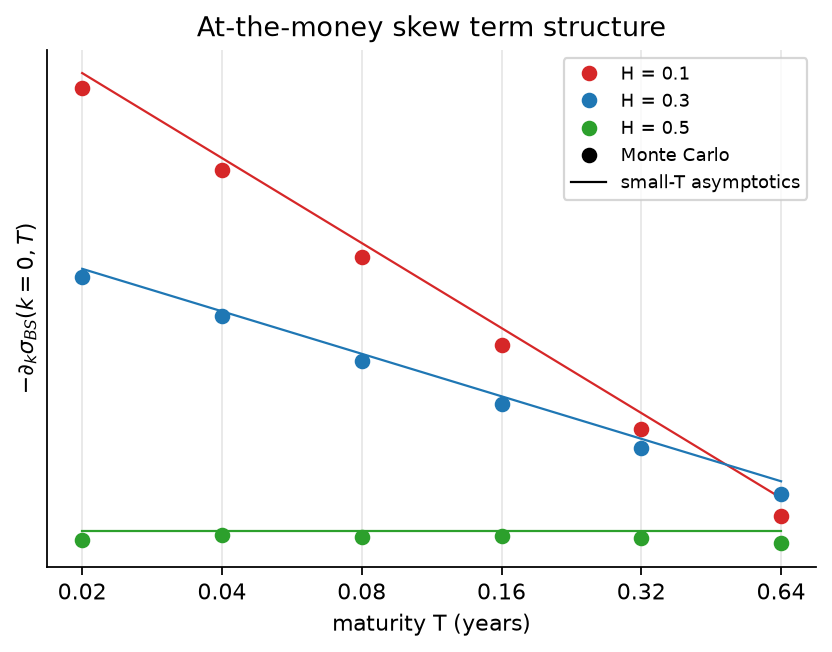

# Monte Carlo simulator and its validation

This note holds the details of the data-generation side of the project. The
main [README](../README.md) treats the simulator as a source of labelled
surfaces; everything needed to trust or reproduce it is here.

## Simulator

The Volterra process `Y` is simulated with the hybrid scheme of Bennedsen,
Lunde and Pakkanen (2017), written in PyTorch and differentiable in all four
parameters. Prices use a conditional ("mixed") Monte Carlo estimator that
integrates the independent Brownian motion analytically, plus antithetic paths
and a control variate. Code: [simulator.py](../src/rbergomi_nn/simulator.py),
[pricing.py](../src/rbergomi_nn/pricing.py).

The mixed estimator with control variate cuts the variance of an at-the-money
price by a factor of about 3.5 at `ρ = −0.9`. That is a modest gain; its main
benefit is that prices are smooth and strictly positive in the strike, so the
implied volatility always exists.

## Validation

No closed formula exists, so the simulator is checked from several independent
directions ([01_validate_simulator.py](../scripts/01_validate_simulator.py)):

| Check | Result |
|---|---|
| Martingale `E[S_t] = S_0`, for `H` = 0.07, 0.25, 0.5 | within 2.5 standard errors at all 400 time steps |
| `H = 1/2` | the scheme reproduces Brownian motion path by path (to 1e-12) |
| `η = 0` | Black–Scholes prices recovered exactly |
| Published prices (Bayer, Ben Hammouda, Tempone 2020, Table 5.1) | all four within 1.2 standard errors, see below |
| Short-maturity skew `∝ T^(H − 1/2)` | fitted exponents −0.404, −0.205, −0.004 against −0.4, −0.2, 0 |
| Convergence in paths | error `∝ N^(−0.48)`, theory `N^(−1/2)` |

| Reference set | Strike | Published | This code | Std. error |
|---|---|---:|---:|---:|
| `H=0.07, η=1.9, ρ=−0.9, ξ0=0.235²` | 1.0 | 0.0791 | 0.07900 | 0.00010 |
| `H=0.02, η=0.4, ρ=−0.7, ξ0=0.1` | 1.0 | 0.1246 | 0.12468 | 0.00011 |
| same | 0.8 | 0.2412 | 0.24122 | 0.00009 |
| same | 1.2 | 0.0570 | 0.05711 | 0.00010 |

